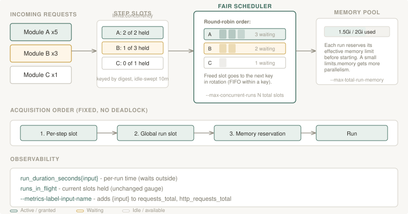

# Governance and performance additions

* Owner: @jonasz-lasut (Jonasz Małecki)
* Reviewers: function-wasm maintainers
* Status: implemented, revision 0.2

The resource-governance one-pager bounds a run by wall clock and linear
memory, the runtime by compiles, resident modules, disk and (optionally)
concurrent runs. The sandbox one-pager bounds egress per run. This
document adds what the 2026-08-16 capabilities research ranked as cheap and
useful, in two phases: per-module egress rate limits, and fairness
inside one runtime (per-Input concurrency, fair queueing, a global
run-memory budget). Each phase is a new
optional Input field or a new flag; none changes an existing one, and every
ceiling keeps the rule that the operator sets it and a Composition may only
lower it. `v0.1.0` doesn't depend on any of this.

Phases the project dropped after drafting them: fuel-based instruction counting
(not portable to wazero), registry mirror / OCI layout / `function
precompile` (path mode covers air-gapped environments), and a raw-bytes
gRPC codec (maintenance cost outweighs the savings for typical XR sizes).

## Invariants across all phases

- **Ceilings are flags, budgets are Input fields, the Input only narrows.**
  A `limits` value over its ceiling is a fatal result that states both, as
  `runOptions` does today. Where no policy enables a capability, the result is
  `requires …, but the runtime has no --sandbox-policy-file, which is required to grant …`.
- **Digests are stated up front, never resolved at request time.** Each
  fetch is still verified against the stated digest, and the caches keep
  their keys.
- **Metric cardinality remains bounded.** New label values are enumerations;
  the only identity label is the opt-in Input name, never a digest, ref
  or host.
- **The guest never sees a trap for a policy decision.** A cache miss, a
  rate limit or a slot wait is an error the guest reads or a fatal result
  the runtime issues - never a trap inside the module.

## ~~Phase 1 - fuel~~ (dropped)

Wasmtime's fuel-based instruction counting (`SetConsumeFuel`, `SetFuel`,
`GetFuel`, `OutOfFuel` trap, codegen change requiring a separate compiled
cache namespace) isn't portable to wazero, the stated fallback engine.
The project can't build features tied to one WASM engine. The epoch
deadline (wall clock) remains the run bound.

## Phase 2 - Egress economy with per-module rate limits

A module called once per XR against the same endpoint makes one request per
reconcile per XR: a thousand XRs are a thousand identical GET requests per sweep.
One addition in `internal/egress`, behind the operator's policy file:

**Per-module rate limits** (`--egress-rate-limit-per-minute` / `--egress-rate-limit-burst`).
A token bucket per module digest in `Egress` (a bounded, idle-expiring map:
the set of digests in use is the memory tier's size, not a metric label),
consulted in `Client.do` after the per-run `maxRequests` check; over the
limit the guest reads `sandbox.egress: the module's request rate exceeds
the egress policy's rateLimit` - `outcome=budget`, never a trap - and
retries next reconcile. Set by the operator flags, like the other budgets, and a Composition can't raise it. A sweep drops idle entries every ten minutes.
Deferred: a per-host bucket (protects a third party across modules - needs
a bounded key set first), a Composition-lowerable egress rate limit.

The project considered response caching and dropped it: the invalidation semantics
(TTL, Cache-Control, key correctness across headers) add complexity out of
proportion to the benefit when modules already run in milliseconds.

## Phase 3 - Fairness inside one runtime

`--max-concurrent-runs` is one FIFO. With it set, a slow module's requests
queue everyone's behind them (the resource-governance one-pager says so),
and without it `runs × --module-memory-limit` is the caller's number. All
four additions are small, in `internal/engine` and `cmd/function`, and
optional:

- **`limits.concurrency`** (int32, ≥ 1): at most N runs of *this step* at
  once - a semaphore keyed by the module's content digest
  (bounded by the set of served digests, idle-expired every ten minutes),
  taken after the module is loaded and before the global slot, waited under
  the request context:
  `waiting for one of this step's 2 run slots (limits.concurrency): context
  deadline exceeded` - a fatal result that isn't counted as a run and took
  no slot. No ceiling: a Composition can only lower; a value over
  `--max-concurrent-runs` is capped without a message. **Implemented.**
- **Fair queueing** when `--max-concurrent-runs` is set: the slot channel
  becomes per-digest queues served round-robin (`engine.fairScheduler`), so
  one hot module takes at most its share of the slots and a request's wait
  is bounded by the number of *modules* waiting, not requests. Without the
  flag, behaviour is unchanged. `RunOptions.Key` (the module digest)
  identifies the queue. M. **Implemented.**
- **`--max-total-run-memory`** (MB, `MAX_TOTAL_RUN_MEMORY`, 0 = off): a run
  reserves its effective memory limit (`limits.memory` or the ceiling) from
  a global pool before it starts and returns it after; a run that can't fit
  waits under its context (`waiting for 512Mi of run memory
  (--max-total-run-memory 2Gi): context deadline exceeded`). Reservation,
  not accounting (the store limiter still caps actual use), so a step that
  states a small `limits.memory` gets more parallelism, an incentive to
  state the true value. Acquisition order is fixed (per-Input slot, global
  slot, memory), so no cycle exists. S. **Implemented.**

Interactions: the resource-governance table gains a row per addition;
`run_duration_seconds` keeps measuring runs (every wait is outside it), and
`runs_in_flight` is unchanged.

## Trust and threats

These additions don't widen what a module can access. The rate limit and
fairness only refuse or delay. The memory pool bounds total reservation.
Threats to test explicitly: a run holding a slot while it waits for memory
(fixed acquisition order, bounded by `ctx`).

## Phasing and effort

| phase | what | effort | lands |
|---|---|---|---|
| ~~1~~ | ~~fuel~~ | - | **Dropped** (not portable to wazero) |
| 2 | egress `rateLimit` (`--egress-rate-limit-*` flags) | S | **Implemented.** |
| 3 | `limits.concurrency`, fair queueing, `--max-total-run-memory` | S, M, S | **Implemented.** |
| ~~4~~ | ~~registry mirror, OCI layout, precompile~~ | - | **Dropped** (path mode covers air-gapped) |
| ~~5~~ | ~~raw-bytes codec~~ | - | **Dropped** (maintenance cost outweighs savings) |

Every phase is additive - new optional `limits` fields, new
flags, new policy-file sections (a strict-parsed file with a new section
needs the runtime that knows it, which concerns the runtime alone and
leaves the Input unchanged), new enumeration values on existing metric
labels. `v0.1.0` doesn't depend on any of this.

## Open questions

- ~~**Fuel as an engine-wide opt-in flag?**~~ Dropped: not portable to
  wazero.
- **Cache key: include the module digest?** Recommendation: yes - a hit rate
  across different modules against the same endpoint doesn't justify making
  the sentence "modules never share responses" conditional.
- **Rate-limit unit: per module digest or per host?** Recommendation: per
  module first (the digest is already the audit's unit and the key set is
  the memory tier's), and per host once the project designs a bounded key set.
- ~~**Opt-in `input` metric label from `metadata.name`?**~~ Dropped: an
  Input is a Composition-embedded fragment, so its `metadata.name` is unset
  in practice (no example sets it) and, when set, is neither unique nor
  informative across the many Compositions one server handles; the label's
  signal was unreliable.
- **Warm-up from a bounded "last served" file on the cache volume?**
  Recommendation: no - it makes the warm set a function of history that a
  fresh volume lacks and an operator can't read from the deployment;
  `--warm-modules` (stated) covers cold starts, and a persistent volume
  already keeps artifacts. Revisit if a real fleet shows the gap.
