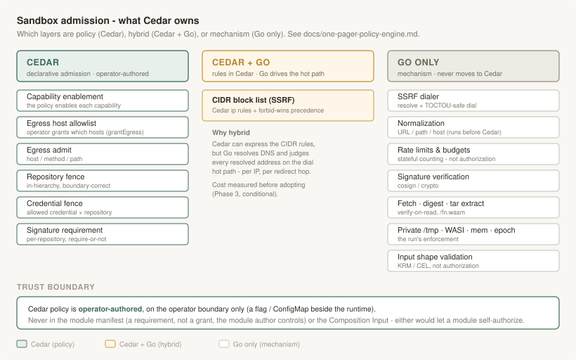
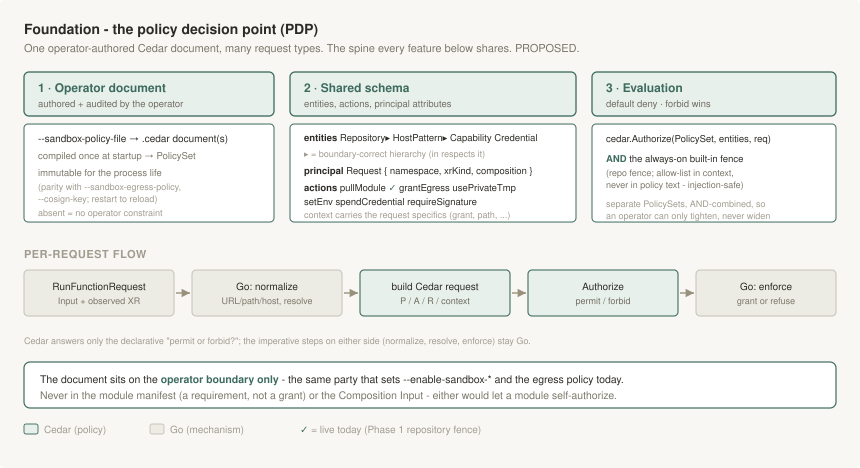
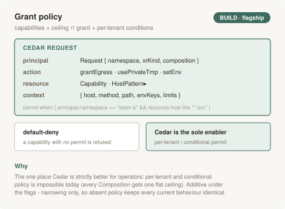
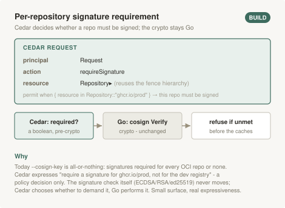
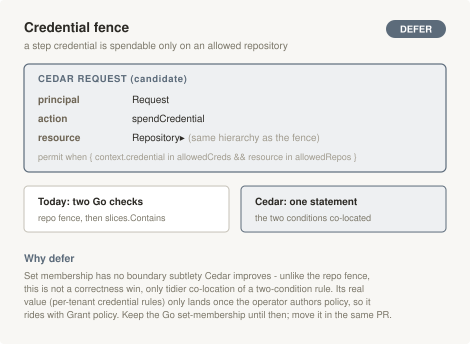
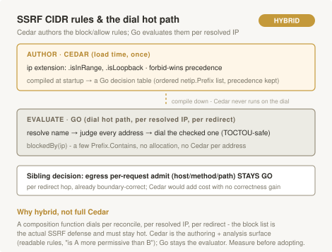

# Policy engine (Cedar) evaluation

* Owner: @jonasz-lasut (Jonasz Małecki)
* Reviewers: function-wasm maintainers
* Status: implemented, revision 0.4

Whether to express function-wasm's sandbox admission decisions - egress rules,
the repository and credential fences, the ceiling that narrows a Composition's
grant - in [Cedar](https://www.cedarpolicy.com) (via the pure-Go
`cedar-policy/cedar-go`) instead of the hand-written Go in `internal/egress`,
`internal/sandbox` and `internal/module`. Written after a review surfaced a
run of small policy bugs (a repository-prefix boundary weakness among them) and
the question of whether the policy layer should become something operators
author rather than something the runtime hard-codes.

In short, Cedar is a **complement that can own the declarative admission
plane**, not a replacement for the sandbox. Its value is real only if
the goal is operator-authored policy; as an internal refactor it's a large
lever for a small problem, and the security-critical mechanism doesn't move to
it. This document maps exactly what can and can't move. The decision then rests
on the boundary rather than on the appeal of a policy language.

## The dividing line - authorization decisions vs. mechanism

Cedar answers one kind of question: *for this principal, action, resource and
context, permit or forbid?* - stateless, over data already materialized.
Everything in the sandbox layer sorts into that bucket (**policy**) or into
**mechanism** - DNS resolution, the TOCTOU-safe dial, normalization,
cryptographic verification, stateful counting, and the WASI/memory/epoch
enforcement. Mechanism isn't an authorization question and can't become
Cedar. The whole decision rests on how much of the sandbox layer is policy.

## Layer map

| Decision surface | Today | Cedar-expressible | Notes |
|---|---|---|---|
| Which capabilities a Composition may grant (`--enable-sandbox-*`) | boolean flags | Yes | `permit(... action == Action::"grantEgress" ...)`; flags become policy |
| Ceiling narrows a grant (egress hosts/patterns, budgets caps) | `egress.Grant`, `sandbox.Ceiling.Grant` | Yes | The grant becomes the authorization *request* and the operator's policy decides. A direct model of the two-party structure |
| Egress request admit (host / method / path) | `egress.Grant.admit` | Yes, after normalization | `.like("*.example.com")`, method as action, path via `.like("/v1/*")` |
| Repository fence (XR-chosen ref) | `module.hasAnyPrefix` | Yes, and *better* | Model repos as an entity hierarchy: `resource in Repository::"ghcr.io/team"`. `in` respects the namespace boundary by construction - the prefix bug can't recur |
| Credential fence | `module.admit` | Yes | `permit(... when { context.credential in allowed && resource in allowedRepos })` |
| Require a signature for repos matching X | `--cosign-key` (all-or-nothing) | Policy: yes | Cedar can decide *whether* to require a signature per-repo, and the crypto remains Go. More expressive than today |
| CIDR block-list judgment (SSRF core) | `egress.blockedBy` on resolved IPs | Rules: yes / driving: no | Cedar's `ip` extension (`.isInRange`, `.isLoopback`) + `forbid`-wins models the rules and precedence, but resolution and the dial stay in Go and the authorizer runs **per resolved IP on the dial hot path** |
| Limits narrowing (timeout/mem/concurrency <= ceiling) | numeric `min` | Expressible, no gain | A one-line clamp; enforcement (epoch, limiter) is mechanism |
| Rate limits / budgets (`maxRequests`, bytes, token bucket) | `egress.ratelimit`, counters | No | Stateful counting over time, and Cedar is stateless. Permanent Go |
| Signature verification (crypto) | `module.signature` | No | Mechanism |
| DNS resolve + TOCTOU-safe dial | `egress.dial` | No | Mechanism - the actual SSRF defense |
| URL/path/host normalization | `NormalizedPath`, `normalizeHost` | No | Must run *before* Cedar; an unnormalized path reintroduces the dot-segment bypass |
| Digest verify / fetch / tar extract / private /tmp / WASI+mem+epoch | resolver, engine | No | Mechanism |
| Input *shape* validation (`host` XOR `hostPattern`, enums) | `sandbox.Validate` + CRD/CEL | No (awkward) | KRM field-shape; stays in Go/CEL |

**Policy plane (top seven rows): a candidate for Cedar.** This is the part an
operator would author, until now scattered across `--enable-sandbox-*` flags
and the (now-removed) `--sandbox-egress-policy` YAML with hand-coded
intersection logic between them. **Mechanism plane (the rest, about 60% of the
sandbox layer): imperative Go forever.** That includes the SSRF dialer and all
stateful budgets, as well as all crypto.

## Where Cedar is more than a different syntax

The following decisions gain correctness or expressiveness beyond a change of
syntax:

- **The repository/credential fence as an entity hierarchy.** Modeling a repo's
  namespace chain as Cedar entities and testing with `in` is boundary-correct by
  construction: `ghcr.io/team` can't admit the sibling `ghcr.io/team-evil`, and
  `https://cdn.example.com` can't admit the adjacent host
  `https://cdn.example.com.attacker.net`. This is the exact class of the bug the
  review found (now fixed in Go on `fix/sandbox-review-findings`); Cedar removes
  the footgun rather than re-encoding the string prefix.
- **Per-tenant and conditional operator policy.** `when { principal.namespace ==
  "team-a" }` and similar are natural in Cedar and impossible today - every
  Composition currently gets one flat ceiling. Add Cedar's schema validation of
  the policy itself and the Rust tooling's "is policy A more permissive than B"
  analysis, and what an operator can express is richer than flags + a YAML
  file.

## Trust model: Cedar sits on the operator boundary only

This is a hard constraint, and it answers the question of whether to embed
Cedar in the module manifest:

- **Not in the module manifest.** The module author writes the
  manifest (`wasmfn.yaml`, the `application/vnd.wasmfn.manifest.v1+json` OCI
  layer) and publishes it inside the artifact. The architecture's invariant
  (`docs/one-pager-module-manifest.md`) is that a manifest is a **request,
  never a grant**: `checkManifest` runs after admission and can only narrow.
  Cedar policy is a `permit`/`forbid` grant language. A module that could
  publish Cedar policy about itself would write its own permits - an attacker's
  module would publish a permissive policy - inverting the trust model. The
  manifest keeps declaring typed requirements (`Requires.Egress`,
  `Config.Schema`, `MinRuntime`); at most those become the entities/context the
  operator's policy evaluates.
- **Not in the Composition.** The Composition author writes the `sandbox`
  block (more trusted than the module, less than the operator) and it stays a
  **request** that the operator's policy decides on; the Composition doesn't
  author `permit` either.
- **On the operator boundary.** The `permit`/`forbid` document lives with the
  runtime - a flag pointing at a file, or a ConfigMap - authored and audited by
  the operator, the same party who runs the Deployment and mounts the policy today. Grants and
  requirements remain data the policy reads.

## Costs and risks

- **A new dependency.** `cedar-go` is pure Go (no CGo - fits the repo) and, as
  of this revision, is `v1.8.0` - past the pre-1.0 concern this doc first raised.
  Its footprint is lean: the only transitive dependency it adds is
  `golang.org/x/exp`. It joins what the weekly Grype supply chain scan covers.
- **Hot-path evaluation.** A composition function runs per reconcile. The costs
  to measure rather than assume are per-request egress admit and
  *per-resolved-IP* block-list evaluation on every dial. The current path is a
  few map lookups and string compares.
- **A second config model during migration**, and an operator adoption tax
  (learning Cedar). Justified only if authorable policy is a goal users are
  asking for.
- **Mechanism is unchanged.** All the imperative Go that enforces the actual
  security is still written and maintained. Cedar sits on top of it.

## Plan (phased, if approved)

De-risk the question of whether the gain justifies the cost with the smallest
slice that proves the operator-authored-policy ergonomics, before touching any
hot path:

1. **The repository fence** in a new `internal/authz` (Cedar) package that
   `internal/module` calls. Smallest surface, the decision where Cedar is
   better on correctness, zero hot-path exposure (runs once per resolve, not
   per request). **Done** (`internal/authz`): the fence is a static Cedar policy
   (`resource in context.allowedRepositories`) over a boundary-correct
   repository entity hierarchy - a location's ancestors are its path-boundary
   prefixes, both slash forms - behind the module package's existing refusal
   strings. The runtime passes the allow list in the request context, never in the
   policy text, so a Composition-authored entry can't inject policy. The
   credential check remains exact set membership (no boundary subtlety Cedar
   would improve).
2. **Measure and decide.** If the slice feels good, egress admit is the next
   candidate and there are real numbers; if not, one package was spent, not a
   rewrite.
3. **Egress admit (conditional on step 2)**, with the normalization staying in
   Go and a benchmark of admit + per-IP block-list evaluation on the dial path.
4. The SSRF dialer, the budgets/rate-limits, the crypto, and the Input's
   field validation remain Go.

## Phase 2+ feature designs

**Released in v0.2.0.** The whole of Phase 2+ is implemented behind the
`--sandbox-policy-file` operator document - the grant policy (capabilities and
ceiling, with per-tenant conditions), the per-repository signature rule, the
SSRF CIDR compiler, and the credential fence. The designs and verdicts below
are the record of the decision; the code matches them, with one change - the
credential fence was built in Cedar with the grant policy rather than remaining
Go (see its section). With Phase 1 merged, this mapped the remaining policy
plane (the top rows of the layer map) into concrete features, each grounded in
the code it replaced (`internal/admission`, `internal/egress`,
`internal/sandbox`, `internal/module`).

### The policy decision point (foundation)

One operator-authored Cedar document (`--sandbox-policy-file`), compiled once at startup
and immutable for the process, deliberate parity with `--cosign-key`
and `--cosign-key` (restart to reload; hot-reload remains a later option the
launch can do without). Absent, the operator doesn't add a constraint and every
current behaviour is identical.

- **Principal** is `Request { namespace, xrKind, composition }` - the only caller
  identity the function actually has, drawn from the observed XR and the pipeline
  step context of the `RunFunctionRequest`. Per-tenant policy has to key on
  something real, and this is it.
- **Entities** are `Repository` and `HostPattern` (the boundary-correct
  hierarchies, `in` respects the boundary), `Capability` and `Credential`.
  **Actions** are `pullModule` (live), `grantEgress`, `usePrivateTmp`, `setEnv`,
  `spendCredential`, `requireSignature`.
- **Evaluation** is default-deny, `forbid` wins. The layers are **separate
  PolicySets, AND-combined**, so one document can only tighten, never widen
  another. Originally the built-in fences (the Composition's allow lists in
  context, injection-safe) beside the operator document; since the
  three-layer model (docs/one-pager-three-layer-authz.md) the Input's
  `compositionPolicy`, the composition author's own PolicySet over the same
  schema, subsumes the fences.

Cedar answers only "permit or forbid?"; the imperative steps on either side
(normalize, resolve, enforce) stay Go.

### Grant policy - build, the flagship

Capability enablement (`usePrivateTmp`/`setEnv`/`grantEgress`), the ceiling intersection
(`sandbox.Ceiling.Grant`, `egress.Egress.Grant`) and limits combine into
one two-party model: the Composition's `sandbox`/`limits` block becomes the
authorization *request*, the operator's policy decides. This is the one decision
where Cedar is *better* and more than a different syntax - per-tenant and
conditional policy (`when { principal.namespace == "team-a" }`) is impossible
today, where every Composition gets one flat ceiling.

**The `--enable-sandbox-*` flags were dropped; the operator policy is the only
enabler (revision 0.4, Jonasz 2026-08-19).** The original design kept the three
`--enable-sandbox-*` booleans as a hard floor the policy could only narrow. That
was reversed. A private `/tmp`, environment and egress are already power-user
configuration most modules never need. Requiring a Cedar `usePrivateTmp` /
`setEnv` / `grantEgress` permit to enable each one, and refusing every sandbox
grant when there is no `--sandbox-policy-file` at all, is the safer default, and
it makes one enablement point rather than two. The base function (run a module
without sandbox extras) still doesn't need any configuration. The
`--egress-rate-limit-*` flags stay (tuning, not enablement); the egress mechanism
is always built and only a `grantEgress` permit enables it. The startup `/tmp`
probe runs only when the policy has a `usePrivateTmp` rule.

**The `--sandbox-egress-policy` file, though, ended up as Cedar (v0.2.0).**
Its declarative parts are exactly what Cedar expresses: the host/pattern ceiling
(this feature, `grantEgress`) and the CIDR block/allow rules (the SSRF feature
below) map directly onto the operator's document, so the standalone YAML with
its bespoke schema was removed - one document, authored and analysable in one
language. Only its budgets and rate limit remained as numeric config: they're
stateful counting over time, which Cedar can't express (see the SSRF and
non-goals sections). The migration waits on the spike, but the destination isn't
in doubt - the egress policy file was always policy written in a YAML syntax.

### Per-repository signature rule - build

Today `--cosign-key` is all-or-nothing. Cedar decides *whether* a repo must
be signed (a boolean, pre-crypto, reusing the `Repository` hierarchy); the cosign
verification in `module.Verifier` doesn't move. Small surface, real
expressiveness, independent of the rest.

### Credential fence - built in Cedar with grant policy

Cedar-expressible (`spendCredential when { context.credential in allowedCreds &&
resource in allowedRepos }`, co-locating the two checks once split across
`module.admit`), and it's set membership with no boundary subtlety for Cedar to
improve: the correctness win of the repository fence is absent here. The fence
is in Cedar anyway, with the grant policy
(`internal/authz/credential_fence.cedar`, a `spendCredential` request from
`module.admit`), co-locating the two-condition rule and reusing the
boundary-correct `Repository` hierarchy; the credential half remains exact set
membership, and the runtime passes both allow lists in the request context, never in
the policy text, so a Composition-authored entry can't inject policy.

### SSRF block and allow rules - hybrid, Cedar-authored / Go-evaluated

Cedar's `ip` extension (`.isInRange`, `.isLoopback`, `forbid`-wins) is a good
*authoring and analysis* surface for the block/allow rules - but `egress.blockedBy`
runs per resolved IP, per redirect hop, per reconcile and is the actual SSRF
defense. For that reason the rules compile to a Go decision table at load and
**Cedar never runs on the dial path**. Its sibling - egress per-request admit
(host/method/path) - **remains fully Go** for the same reason: it's already
boundary-correct and hot, with nothing to gain. The operator-authored part of
egress - the *ceiling* (may this Composition grant this host) - is the "Grant
policy" feature in the preceding section, evaluated once at admission rather
than per hop.

### Verdicts and sequencing

| Feature | Verdict | Why |
|---|---|---|
| Grant policy (capabilities + ceiling + per-tenant) | **Build** - flagship | The only decision where Cedar is better outright; additive under the flags |
| Per-repo signature rule | **Build** | Per-repo is finer than all-or-nothing `--cosign-key`; crypto unchanged |
| Credential fence | **Built** | Built in Cedar with grant policy; no correctness gain, but co-locates the two-condition rule |
| SSRF CIDR rules | **Hybrid** | Cedar authors, a Go table evaluates on the hot path |
| Egress per-request admit | **Stays Go** | Hot, per-redirect, already boundary-correct |

Sequencing keeps the plan's gate at every step:

1. **Foundation + grant policy** (fold in the credential fence, which shares the
   repository hierarchy). Proves operator-authored-policy ergonomics at the cheap
   end - admission-time, outside any hot loop. One package spent if it feels
   wrong.
2. **Measure**, then decide on egress/SSRF.
3. **Per-repo signature** - small, independent, can land any time after the
   foundation.
4. **SSRF CIDR** only behind a benchmark. Egress per-request admit never moves.

With the host/pattern ceiling (step 1) and the CIDR rules (step 4) both in Cedar,
the `--sandbox-egress-policy` YAML was removed in v0.2.0: its declarative half is
policy and its budgets are fixed defaults, while its one stateful setting (the
rate limit) is a flag (`--egress-rate-limit-per-minute` /
`--egress-rate-limit-burst`).

## Non-goals

- Replacing the SSRF dialer, the budgets, the rate limiter, the signature
  verifier, or the digest/fetch/tar mechanism with Cedar.
- Cedar policy in the module manifest or the Composition Input (trust-model
  inversion - see the trust model section).
- A big-bang migration of the whole policy layer. Every step waits for the
  phased spike's verdict.
- Changing the operator's flags or the egress policy file before a spike proves
  the Cedar model. The current settings remain until then.

## Alternatives considered

- **Keep the custom Go (do nothing).** The policy code is well-tested and, with
  the review fixes merged, correct. This is the right choice if operator-authored
  policy isn't a goal - the maintenance pain came from rough edges in a sound
  architecture.
- **OPA / Rego.** A more mature engine with a Go host, but a larger dependency
  and a general-purpose language where Cedar's authorization-specific model
  (entities, `in`, `forbid`-wins, schema, analysis) is the closer fit for this
  problem and the better match for the fence hierarchy.
- **Fix the bugs, express nothing in a policy engine.** Done for the immediate
  security bug; this one-pager exists because the *longer-term* operator-authored
  direction is a separate, deliberate call.

## Open questions

- Is operator-authored, auditable policy a goal real users are asking for, or is
  the motivation internal tidiness? Proceeding past the spike depends on the
  answer.
- ~~`cedar-go`'s 1.0 status~~ - resolved: `v1.8.0` is in use. Semantics parity
  with the Rust engine for the features beyond the fence (the `ip` extension,
  `.like`) still to confirm when egress admit is considered.
- Measured per-request and per-dial evaluation cost against the current path.
- ~~Where the operator's Cedar document lives and how it reloads~~ - designed
  (Phase 2+, foundation): a `--sandbox-policy-file` read at startup and immutable for the
  process, parity with `--cosign-key`; a mounted ConfigMap satisfies
  the flag, and restart reloads. Hot-reload stays a later option.

## References

- `docs/one-pager-sandbox.md` - the grants and the egress ceiling this would
  express
- `docs/one-pager-trust-model.md` - the parties and why policy is operator-only
- `docs/one-pager-module-manifest.md` - a request, never a grant, and why Cedar
  stays out of the artifact
- `docs/one-pager-module-source-schema.md` - `policy` (the repository/credential
  fence)
- Cedar: https://www.cedarpolicy.com , `cedar-policy/cedar-go`
